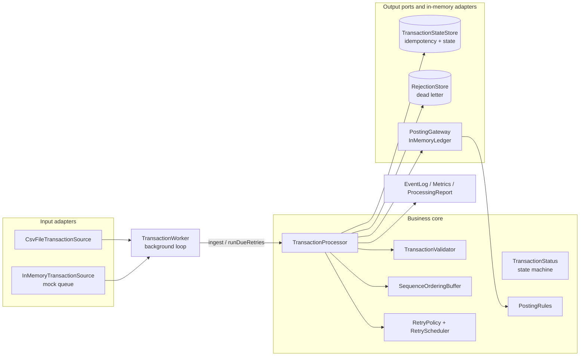

# Design Note: Idempotent Background Transaction Processing Service

## 0. Problem framing and assumptions

The core risk for the customer is **money moving twice, or moving in the wrong order**. The input
mechanism is incidental. So the design question is: *what has to be true for every request,
however many times or in whatever order it is delivered, so the ledger ends up exactly as if each
transaction had been applied once, in order?*

Assumptions (each would be confirmed with the customer in a real engagement):

| # | Assumption | Why it matters |
|---|---|---|
| A1 | `transactionId` is the **business** identity; `requestId` is the **delivery** identity (one transaction can arrive under several requestIds). | Two dedup keys with different meanings (section 2). |
| A2 | `sequenceNumber` is assigned by the upstream producer and is gap-free within its scope. In the brief's data it is **global** (1 to 5 across accounts). Per-account sequencing is supported by configuration. | Defines the ordering strategy (section 3). |
| A3 | The side effect is a ledger posting with a balance that must not go negative. | Gives ordering a real consequence: a DEBIT applied before its CREDIT would wrongly fail. |
| A4 | The downstream posting system accepts an idempotency key (`transactionId`). Most payment and core-banking APIs do. | This is what makes retry after an *unknown outcome* safe (section 4). |
| A5 | Currency isn't in the brief's table; USD is assumed. Amounts must be positive and respect the currency's minor units. | Validation rules. |
| A6 | In-memory persistence is acceptable for the exercise. Every store sits behind a port with a documented DB mapping. | Section 8. |

## 1. Architecture

Hexagonal (ports and adapters). The business core has no knowledge of CSV, threads or storage technology.

Request flow inside `TransactionProcessor`:

1. **Validate.** If invalid, write to the dead letter (`REJECTED`) and release its sequence slot (configurable). The batch continues.
2. **Claim** the dedup keys atomically. The outcome is `NEW`, `DUPLICATE_REQUEST`, `DUPLICATE_TRANSACTION` or `CONFLICT`.
3. **Admit** through the sequence buffer: `READY` (process now), `BUFFERED` (`PENDING`), or a sequence conflict (`REJECTED`).
4. **Post** through the idempotent gateway, which gives `PROCESSED`, `RETRY_PENDING` (transient error) or `FAILED` (business rule, or retries exhausted).
5. On a terminal outcome, **complete the slot**, which releases the next buffered sequence. Steps 4 and 5 repeat for it.

The background job (`TransactionWorker`) is a poll loop: *poll source, ingest each record in
isolation, run due retries, idle until the next record or retry*. It runs on its own thread
(`App` uses a single-thread executor), supports graceful stop via a shutdown hook, and in batch
mode ends when the source is drained **and** no retries remain outstanding.

## 2. Idempotency design and duplicate detection

There are three layers, each closing a different gap:

| Layer | Key | Catches | Implementation |
|---|---|---|---|
| 1. Request dedup | `requestId` | Redelivery of the same message (at-least-once queues, client retries) | `claim()` index `requestId -> transactionId` |
| 2. Business dedup | `transactionId` + **payload fingerprint** | Same transaction resent under a new requestId (row 3 of the brief: `REQ-2-DUP`) | SHA-256 of the business fields (excludes requestId, eventTime, sourceRef; amount normalised so `100` = `100.00`) |
| 3. Effect dedup | `transactionId` at the posting gateway | A retry after the outcome was **unknown**: the downstream committed but the ack was lost | `InMemoryLedger` treats transactionId as a unique key and returns `ALREADY_APPLIED` |

Decision table in `claim()`:

| requestId seen? | transactionId seen? | fingerprint equal? | Outcome |
|---|---|---|---|
| no | no | n/a | **NEW**: record created as `RECEIVED` |
| yes (same txn) | yes | yes | **DUPLICATE** (`matchedOn=REQUEST_ID`) |
| no | yes | yes | **DUPLICATE** (`matchedOn=TRANSACTION_ID`), and the new requestId is indexed |
| no | yes | **no** | **REJECTED `IDEMPOTENCY_KEY_CONFLICT`**: same id, different money. Never silently treated as a duplicate, never processed; the original is untouched. |
| yes, for a different txn | any | any | **REJECTED `IDEMPOTENCY_KEY_CONFLICT`** |

Points worth calling out:

* **Dedup happens on first claim, not on completion.** A duplicate that arrives while the original is
  still `PENDING` or `RETRY_PENDING` is detected (tested). Deduping only against `PROCESSED`
  records is a common bug that double-processes during retries.
* **Duplicates are detected "even if they arrive later in the batch"** or in a later batch:
  re-running a whole file changes nothing (tested by `replayingAWholeBatchChangesNothing`).
* `claim()` is the atomic gate. In memory it is `synchronized`; in a database it is an `INSERT`
  guarded by unique constraints on `transaction_id` and `request_id`. A constraint violation means
  "duplicate", so correctness never depends on a read-then-write race. A 16-thread test checks that
  exactly one claimant wins.

## 3. Out-of-order handling: sequence-based (option A)

**Choice:** sequence-based processing with a per-partition buffer.

* Each partition keeps `nextExpected`. A request with `seq == nextExpected` is processed; a later
  one is parked as `PENDING`; once the current one reaches a terminal state the next buffered
  sequence is released, and so on in a chain.
* **At most one in-flight transaction per partition.** If seq 5 is `RETRY_PENDING`, seq 6 waits.
  This is deliberate head-of-line blocking: a DEBIT must not be evaluated against a balance that
  an earlier, still-retrying CREDIT hasn't reached yet (`debitArrivingBeforeItsFundingCredit...` test).
* **Gaps are reported** (`missingSequences` in the report) rather than guessed around.
* **Conflicts:** a *new* transaction that claims a sequence already consumed or held by another
  transaction is `REJECTED SEQUENCE_CONFLICT`. Dedup runs *before* ordering, so a late replay of
  an old transaction is reported as `DUPLICATE`, not as a conflict.
* **Poison records do not wedge the stream.** If a record fails validation but carries a readable
  sequence number, its slot is resolved (like committing a Kafka offset after dead-lettering).
  This is how row 5 (`TXN-2004`, amount -10, seq 4) doesn't block row 6 (seq 5). It is
  configurable (`ordering.rejectedRecordsReleaseSequence`), because a stricter customer may prefer
  to halt the partition for manual repair.
* **Permanently FAILED transactions also release the slot.** Otherwise one bad transaction would
  block everything behind it forever. The failure is visible in the report and the exit code,
  and the transaction can be replayed.

**Scope:** `GLOBAL` (default, matches the brief's data, behaves like one queue partition) or
`ACCOUNT` (independent sequence per account, so accounts don't block each other). Production
would normally be `ACCOUNT` combined with partitioning by `accountId` on the queue.

**Why not the alternatives:**
* *Option B, state-based:* fits a lifecycle of events on one entity (authorise, capture, refund).
  Here every request is a separate monetary movement, and the ordering that matters is *between*
  transactions on a balance. State rules alone wouldn't stop a debit overtaking its credit.
* *Option C, latest-state wins:* acceptable for idempotent "set" semantics (profile updates), but
  **unacceptable for ledgers**. Credits and debits are additive deltas; dropping an "older" one loses money.

**Trade-offs accepted:** head-of-line blocking (bounded by retry backoff and max attempts) and the
need for a gap timeout or alert in production (section 8).

## 4. Retry and failure handling

Failures are classified explicitly:

| Class | Example | Handling |
|---|---|---|
| Validation | negative amount, bad currency, malformed row | `REJECTED`, dead letter with field:code reasons, never retried |
| Idempotency conflict | same transactionId, different payload | `REJECTED`, dead letter |
| Business rule (`BusinessRuleViolation`) | `INSUFFICIENT_FUNDS`, `ALREADY_REVERSED`, `ORIGINAL_NOT_FOUND` | `FAILED` immediately; retrying can't change the answer |
| Transient (`TransientPostingException`) or unclassified runtime error | timeout, 503, connection reset | `RETRY_PENDING`, then retried with bounded exponential backoff (100 ms, 200 ms, ... capped at 2 s; 3 attempts by default), then `FAILED RETRIES_EXHAUSTED` |

Retry never breaks idempotency because the *same* `transactionId` goes to the gateway on every
attempt. Two failure modes are simulated, and the second is the one that catches people out:

* `BEFORE_COMMIT`: nothing was written; the retry simply applies it.
* `AFTER_COMMIT`: the ledger **committed**, but the caller got a timeout. A naive retry would post
  twice. Here the retry gets `ALREADY_APPLIED`, the transaction is marked `PROCESSED` with that
  reason, and `IDEMPOTENT_REPLAY` is counted. See `lostAcknowledgementAfterCommitDoesNotDoublePost`
  and TXN-3004 in the edge-case sample.

**Traceable and recoverable:**
* Every transaction carries an audit trail (`RECEIVED>PROCESSING>RETRY_PENDING>PROCESSING>PROCESSED`)
  with a reason and timestamp per transition, plus its attempt count.
* Dead-lettered requests keep their `sourceRef` (`file.csv:line`) and reason codes.
* `TransactionProcessor.replayFailed(txnId)` moves `FAILED` to `RETRY_PENDING` with a fresh retry
  budget, and is safe to call repeatedly because posting is idempotent. This is the operator path
  after a downstream outage is fixed (tested).

**Data consistency.** Each posting is one atomic unit of work. The ledger computes the new
balance and evaluates every rule *before* mutating anything, then writes the journal entry,
balance and reversal marker together under one lock. A rule violation leaves no partial state
(`failedDebitLeavesNoPartialState`). State transitions go through an enforced state machine
(`TransactionStatus.canTransitionTo`), so for example `PROCESSED -> PROCESSING` is impossible.
If the process died between the ledger commit and the `PROCESSED` write, the record would be left
in `PROCESSING`. Recovery is to re-drive it: the idempotent gateway answers `ALREADY_APPLIED`.
With a real database, the state update and an outbox row go in the same DB transaction as the
ledger write (section 8).

## 5. Observability

* **Structured logs** (`event=TXN_PROCESSED txnId=TXN-2001 attempt=1 posting=APPLIED`): single-line
  `key=value`, which parses directly in Splunk, ELK or CloudWatch. Events: `WORKER_STARTED/STOPPED`,
  `TXN_PENDING`, `TXN_RELEASED`, `TXN_PROCESSING`, `TXN_PROCESSED`, `TXN_DUPLICATE`, `TXN_REJECTED`,
  `TXN_RETRY_SCHEDULED`, `TXN_FAILED`, `TXN_REPLAY_REQUESTED`, `TXN_INTERNAL_ERROR`.
  Levels carry meaning: WARN for rejected or retrying, ERROR (SEVERE) for failed.
* **Metrics** (`ProcessingMetrics`): event counters such as RECEIVED, DUPLICATE, REJECTED,
  BUFFERED_OUT_OF_ORDER, PROCESSED, IDEMPOTENT_REPLAY, RETRY_SCHEDULED, RETRY_ATTEMPTED and FAILED.
  They map one-to-one to Micrometer/Prometheus counters.
* **Processing report** (console and JSON): requests by *final* status (they sum to the number
  received), unique transactions by status, per-request decisions in arrival order, per-transaction
  lifecycle, dead letters, **missing sequences**, and masked balances.
* **Exit code** `2` when FAILED or PENDING work remains, so a scheduler can alert without parsing output.

## 6. Security and data handling

* Account ids are **masked** (`****201`) in logs and reports; amounts are never logged per
  transaction and appear only as aggregated balances in the report.
* Validation errors are `field:CODE` only and **never echo the input value** (tested), so a card
  number pasted into the amount field can't leak into logs.
* Log values are sanitised (control characters stripped, values quoted) to prevent **log injection**
  from input data. Exceptions are logged by class name only, because downstream error messages can
  contain customer data.
* Identifiers are allow-listed (`[A-Za-z0-9._:-]`, up to 64 characters); amounts have an upper
  limit; currencies are checked against ISO 4217.
* No secrets exist or are hardcoded. Configuration comes from a properties file plus `-Dtxn.*`
  overrides; a real adapter would read credentials from the environment or a secret manager.
* The CSV adapter fails fast on missing required columns (a configuration error) but isolates bad
  rows (data errors).

## 7. AI-assisted development: how I used it and how I validated it

I used **Claude Code** (Anthropic) as a pair programmer in VS Code. I treated it like a fast junior
engineer: good at producing a first draft quickly, but every decision that affects money had to be
justified by me and proven by a test before I accepted it.

**Where AI saved me time:**
* Turning the brief into a requirement-to-component map (the table in the README), so I could see
  early that the input mechanism was the easy part and idempotency plus ordering were the real work.
* Boilerplate: records, the CSV adapter, the small JSON writer, the report formatting, the build setup.
* Drafting a broad test matrix (18 validation cases, ordering permutations). I then went through
  each test to make sure it asserted the business outcome (balances, single posting, status), not
  just "no exception".

**Where I pushed back or changed the design:**
* **Dedup on first claim, not on completion.** A simple "has this transaction already been processed?"
  check would let a duplicate through while the original is still pending or retrying. I made the
  claim itself the dedup gate and added a test for a duplicate arriving during PENDING.
* **Same ID, different payload.** Treating every repeated transactionId as a harmless duplicate would
  hide a resend with a different amount. I added a payload fingerprint and an explicit
  `IDEMPOTENCY_KEY_CONFLICT` rejection.
* **The lost-acknowledgement case.** Simulating only "fail before write" makes retries look safe
  when they aren't. The dangerous case in real payment systems is a timeout *after* the downstream
  has committed, so I added the `AFTER_COMMIT` fault mode and made the posting gateway idempotent by contract.
* **One bad record must not stop the stream.** With strict sequencing, row 5 of the brief (invalid
  amount) would have blocked row 6 forever. I let rejected and permanently failed records release
  their slot, and made it configurable, because some customers would rather halt and repair.
* **A misleading status reason.** The first version labelled pending records `WAITING_FOR_SEQUENCE_n`.
  When I ran the edge-case file I saw that the label went stale as other records arrived. I changed
  it to a stable reason and added a live "missing sequences" section to the report.
* **Deterministic tests.** I asked for the clock and the sleep to be injectable so retry backoff
  is tested without real waiting, which keeps the suite fast and not flaky.

**How I validated it:**
1. Read every generated change myself before keeping it.
2. Wrote targeted tests for the risky scenarios (duplicates, out-of-order, retries, partial failure)
   and made sure they would fail if the protection were removed.
3. Ran both sample files through the real command-line app and read the logs and the report line by line.
4. Checked the money by hand: ACC-201 = 100 - 40 + 25 = 85, ACC-203 = 500, one ledger entry per transaction.

## 8. Production hardening: next steps

| Area | Recommendation |
|---|---|
| **Persistence** | PostgreSQL. `transactions(transaction_id PK, request_fingerprint, status, attempts, next_attempt_at, version, ...)`, `request_keys(request_id PK, transaction_id)`, `transaction_history`, `dead_letter`, `partition_watermark(partition_key PK, next_expected)`. Claim = INSERT with unique constraints; transitions = `UPDATE ... WHERE status=? AND version=?`. |
| **Atomicity** | Ledger write, state change to `PROCESSED`, watermark advance and an **outbox** event in **one DB transaction**. Publish downstream events from the outbox (Debezium or a poller) for exactly-once *effects* over an at-least-once transport. |
| **Queue semantics** | Kafka/SQS FIFO keyed by `accountId`, **commit the offset only after the state is durable**, and rely on the idempotency layers for redelivery. A DLQ topic for rejected records. |
| **Concurrency and scale** | One active consumer per partition (consumer groups); horizontal scale = more partitions. If several workers poll a table: `SELECT ... FOR UPDATE SKIP LOCKED`. Switch default scope to `ACCOUNT`. |
| **Gap handling** | Alert when a gap stays open longer than N minutes; an operator action to "skip sequence n" with an audit reason. Optionally a bounded buffer size per partition. |
| **Retry** | Add jitter to backoff; a circuit breaker around the posting gateway; a retry topic or `next_attempt_at` polling instead of in-memory scheduling; distinguish 4xx from 5xx in the HTTP adapter. |
| **Crash recovery** | On startup, sweep `PROCESSING` older than a lease timeout back to `RETRY_PENDING`; it is safe because of the idempotent gateway. |
| **Observability** | Micrometer, then Prometheus/Grafana: throughput, p95 latency, retry rate, DLQ depth, pending age, gap age. OpenTelemetry trace id propagated from the message headers. JSON log encoder. Alerts on FAILED > 0, DLQ growth, and gap age. |
| **Security** | Encrypt PII at rest, keep the fingerprint (already a hash) instead of raw payload in the dedup index, mTLS to downstream, secrets from Vault or a cloud secret manager, and a retention policy for the dedup window. |
| **Operability** | Admin API: replay FAILED, inspect a transaction's history, skip a gap, re-drive DLQ after fix. Run as a Spring Boot service with health and readiness probes and graceful shutdown that drains in-flight work. |
| **Dedup retention** | Define the dedup window with the customer (e.g. 30-90 days) and enforce it with TTL or partitioned tables, so the index doesn't grow without bound. |

## 9. Known limitations (deliberate for scope)

* All state is in memory; a restart forgets dedup history and pending buffers (see section 8 for the persistent design).
* One processor instance is single-threaded (`synchronized`); scale-out is via partitioning, not via threads in one instance.
* The CSV adapter doesn't support quoted fields (none are needed by this model).
* The request audit list in the processor is per run and unbounded; production would store it, not hold it in memory.
